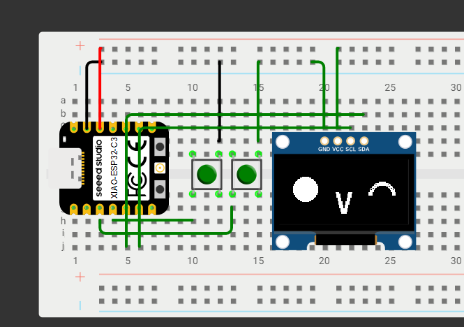

This is a PCB based on TA-TA from the game Arknight endfields.

Features include:

OLED screen for faces
Temperature sensor
Buzzer
Onboard battery charger
IMU to detect movement and orientation.

Current firmware can only display a single face, but would be updated in the future.